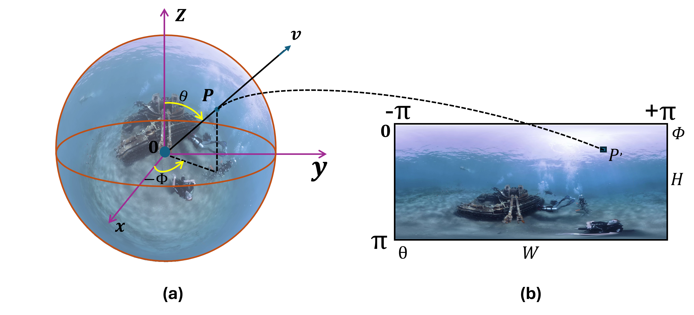
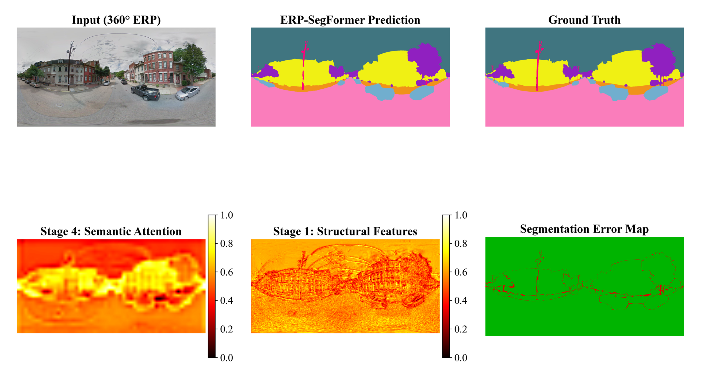
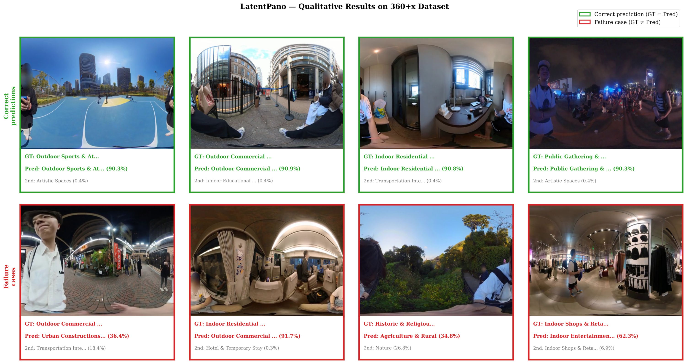
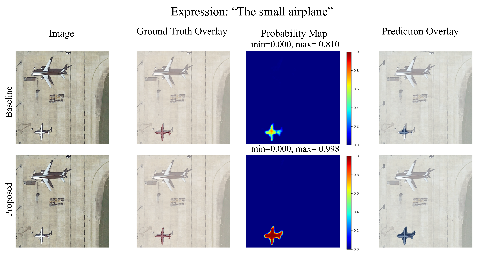
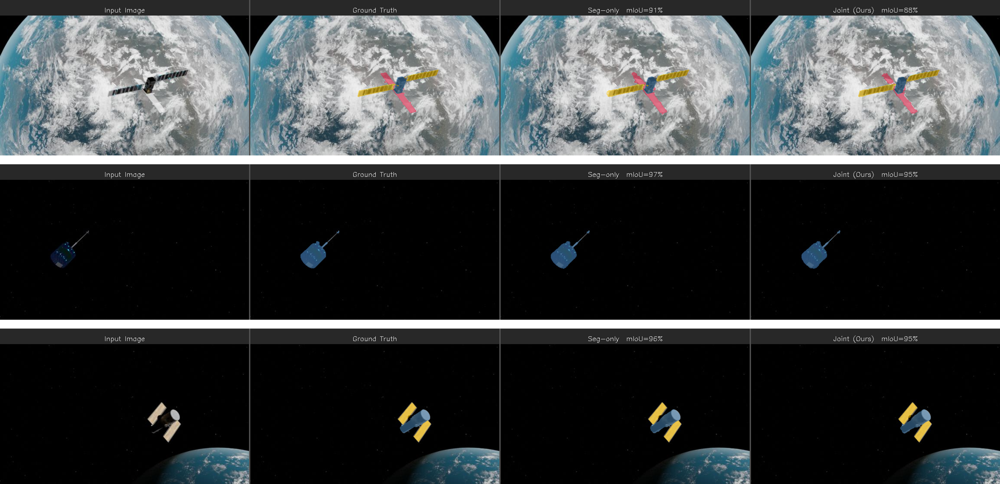
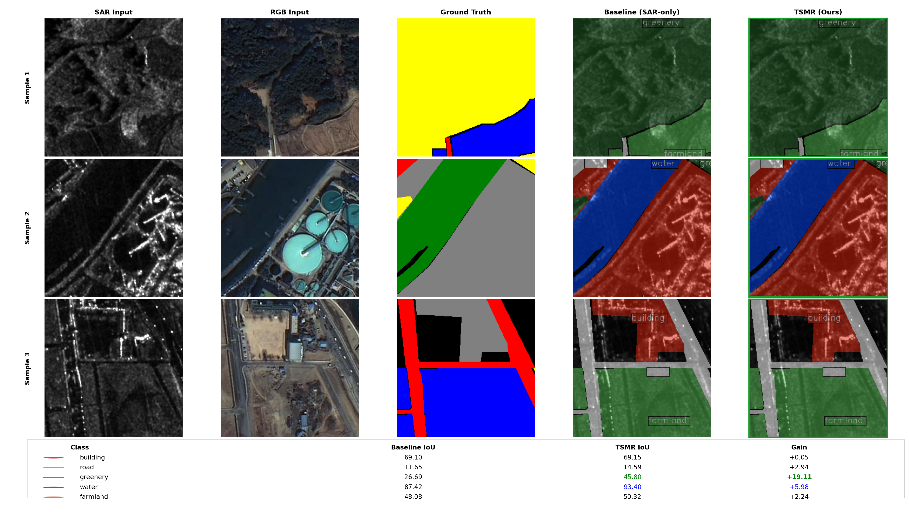
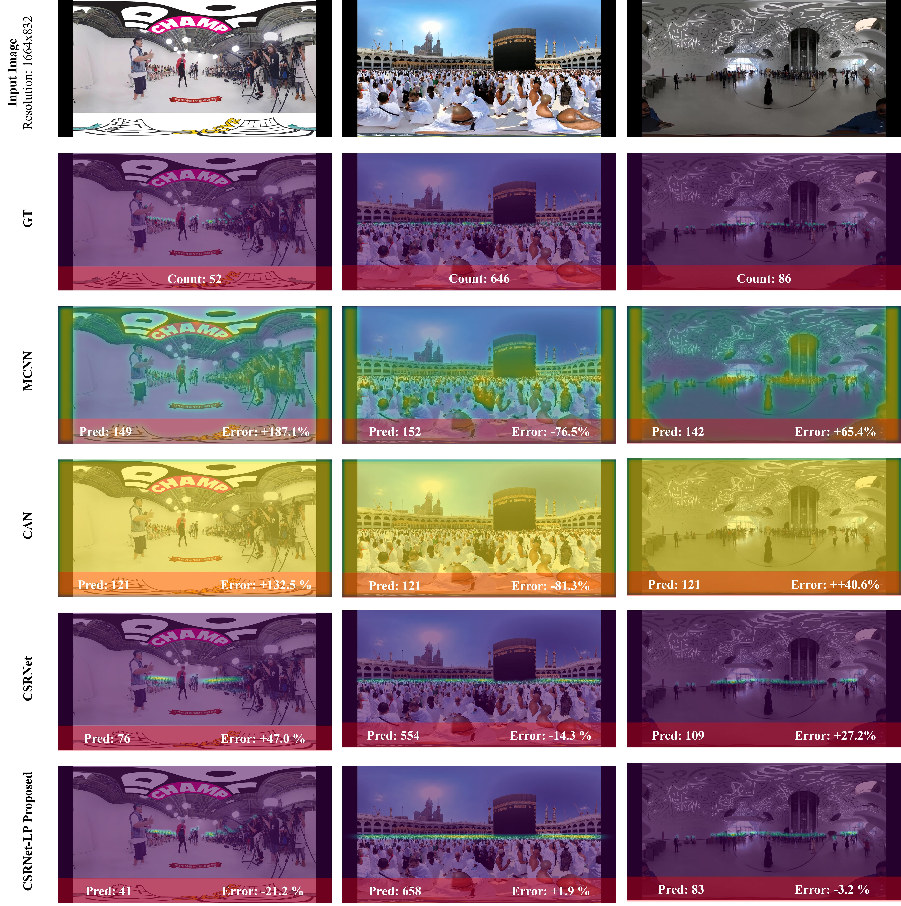

# Ghulam Arbi（爱国） — PhD (Doctor), Computer Vision | USTC

  

**360° / equirectangular (ERP) panoramic computer vision** · latitude-aware attention · semantic / referring / open-vocabulary segmentation · crowd counting · remote sensing · space-target perception.

PhD (Doctor) in Computer Science & Technology, [University of Science and Technology of China (USTC)](https://en.ustc.edu.cn/). Advisor: Prof. Yanyong Zhang. Thesis: *Exploring Segmentation in Panoramic Vision Using Attention Mechanisms*.

[Website](https://aiguo112.github.io/) · [CV (PDF)](https://aiguo112.github.io/CV_Ghulam_Arbi.pdf) · [Publication list](https://aiguo112.github.io/Publication_List_Ghulam_Arbi.pdf) · [ORCID](https://orcid.org/0009-0002-7365-0293) · [LinkedIn](https://www.linkedin.com/in/arbiarbii) · Email: arbi@mail.ustc.edu.cn

**10 papers accepted · 5 under review · 3 public panoramic benchmarks**

  

---

## Research highlights

### PanoDive360 — Underwater 360° semantic segmentation
Novel underwater ERP dataset with enhanced attention for multiclass segmentation under polar distortion.

### ERP-Transformer — Outdoor panoramic segmentation
SegFormer + squeeze-and-excitation channel recalibration for outdoor 360° scenes.

### LatentPano — 360° scene classification
Latitude-aware spatial transform for robust indoor / outdoor / commercial ERP classification.

### SA-RSRefSeg — Scale-aware referring remote sensing
Natural-language referring segmentation for high-resolution aerial imagery.

### Detect-Then-Segment — Space target perception
Two-stage pipeline for non-cooperative satellites / spacecraft.

### Text-Steered Modality Routing — SAR–optical fusion
Annotation-free SAR + optical land-cover segmentation steered by language.

### Beyond Perspective — Panoramic crowd counting
Latitude-aware density maps for 360° ERP crowd counting.

---

## Publications (15)

### Accepted (10)

1. Beyond Perspective: Latitude-Aware Crowd Counting in Equirectangular Panoramic Imagery — **PRICAI 2026** · [code](https://github.com/aiguo112/PanoCount360)
2. Text-Steered Modality Routing for Annotation-Free Open-Vocabulary SAR-Optical Segmentation — **ICAIMS 2026**
3. SA-RSRefSeg: Scale-Aware Attention Prompting for Referring Remote Sensing Image Segmentation — **PRCV 2026** · [code](https://github.com/aiguo112/SA-RSRefSeg)
4. Detect-Then-Segment: A Unified Pipeline for Non-Cooperative Space Target Perception — **PRCV 2026**
5. LatentPano: Latitude-Aware Spatial Transformer for 360° Panoramic Scene Classification — **IICAIET 2026**
6. Content-Conditioned Cyclic Seam Carving for Equirectangular Panoramas — **AMICT 2026** · [code](https://github.com/aiguo112/ERP-Seam-Carving)
7. Leakage, Shortcuts, and Shift: An Evaluation-Integrity Audit of Smartphone-Based Anemia Screening — **AMICT 2026** (coauthor)
8. HemaFormer: Report-Supervised Multi-Task Learning for Anemia and RBC Morphology on AneRBC — **AMICT 2026** (coauthor) · [code](https://github.com/aiguo112/HemaFormer)
9. The Cost Model Is the Bottleneck: Per-Tile Split Allocation for 360° Segmentation with Measured Network Latency — **IEEE CSCloud 2026** · [code](https://github.com/aiguo112/omnisplit360)
10. OmniOrbit: Advancing Space Situational Awareness with a Multi-Task 360° Vision Benchmark — **ACM Multimedia Asia 2026** · [code](https://github.com/aiguo112/OmniOrbit)

### Under review (5)

11. PanoDive360: A Novel Equirectangular Projection Dataset and Enhanced Attention Mechanism for Underwater 360-Degree Multiclass Semantic Segmentation — **ACM Multimedia Asia** · [code](https://github.com/aiguo112/PanoDive360)
12. ERP-SegFormer: Feature Recalibration for Outdoor Panoramic Image Segmentation with Squeeze-and-Excitation Block — **ACM Multimedia Asia**
13. Phenological Contrast: A Geography-Agnostic Prior for Cross-Geography Field Boundary Segmentation — **IEEE JSTARS** · [code](https://github.com/aiguo112/tcbm-field-boundary-segmentation)
14. Tinyship-Fingerprint: Compact Open-Set Individual Vessel Identification from Underwater Acoustic Emissions — **ICASSP 2027** · [code](https://github.com/aiguo112/tinyship)
15. When Contextual Evidence Conflicts: Causal Localization of Order-Sensitive Evidence Selection in LLMs — **ECIR 2027** · [code](https://github.com/aiguo112/when-contextual-evidence-conflicts)

---

## Featured code

| Repo | Topic |
|------|--------|
| [ERP-Seam-Carving](https://github.com/aiguo112/ERP-Seam-Carving) | Cyclic seam carving for ERP · AMICT 2026 |
| [PanoCount360](https://github.com/aiguo112/PanoCount360) | Latitude-aware panoramic crowd counting · PRICAI 2026 |
| [PanoDive360](https://github.com/aiguo112/PanoDive360) | Underwater 360° segmentation dataset & benchmark |
| [SA-RSRefSeg](https://github.com/aiguo112/SA-RSRefSeg) | Referring remote-sensing segmentation · PRCV 2026 |
| [OmniOrbit](https://github.com/aiguo112/OmniOrbit) | Multi-task 360° SSA benchmark · ACM MMAsia 2026 |
| [omnisplit360](https://github.com/aiguo112/omnisplit360) | Edge–cloud per-tile split · IEEE CSCloud 2026 |

---

## Education

- **PhD (Doctor)** CS & Tech, USTC, 2018–2026
- **MS** ECE, SCUT, 2016–2018
- **BS** CS, Islamia University of Bahawalpur, 2010–2014

Languages: English · Chinese (HSK 3)
